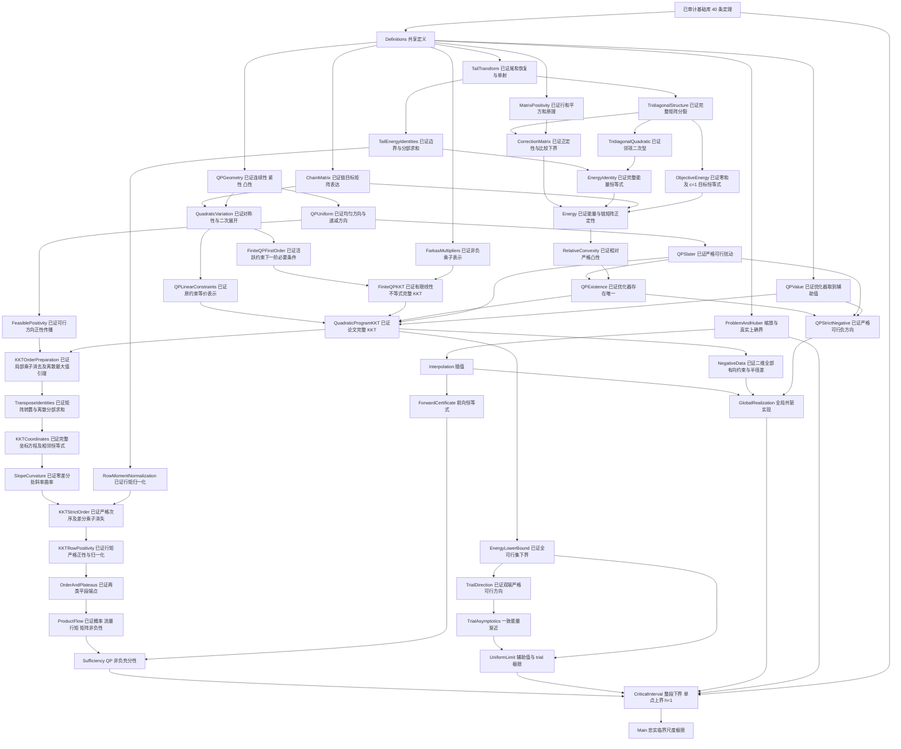

# 框架与依赖链

入口：`PaperFramework.lean` → `PaperFramework/Main.lean`。
所有新定理位于 `CriticalExtrapolation.Paper` 命名空间。
主定理通过实际有效区间与严格失败点的夹逼完成；全部源占位已消除，两次完整构建及最终全库独立审计均通过。

下面是证明链的概念依赖图，不是从 Lean 内核导出的常量依赖图。
该图展示证明结构；准确的模块导入关系和公理依赖以验证目录中的实际输出为准。
实际模块导入关系由 `check_framework.ps1` 保存到 `verification/framework_imports.json`。

## 已完成的证明组合

1. 双端 baseline 能量的 4 log N 主项及原 TrialAsymptotics 连接已完整编译，扩展独立审计已通过；完整参数一致扰动与归一化组合也已证明。
2. 两个缩放一致极限已完成并接回；真实能量估计、QP 全可行集下界、严格可行 trial 与末端修正均保留。
3. 整段有效性、单点失败、h=1 逐函数衔接与最终临界区间的完整组合已通过主入口编译。前向证书、一般有限插值、半径等号嵌入、达界及实际二维反例已经独立审计。
4. 完成后单独核对实际定义、假设和结论，完整重编并逐条审计全部 699 条项目定理；全部通过。

完整 KKT 已由活跃约束下一阶必要条件与非负乘子表示推出，包含互补性和等式乘子识别；未提前令差分乘子为零。
行矩归一化已通过有限望远镜求和独立证明，不依赖严格次序或行矩正性。
严格次序使用完整 KKT 下的零差分曲率不等式和乘子支撑上的有限最大值原理；差分乘子为零是推导的结论。
行矩正性从首行向后传播：若下一行非正，互补条件迫使相邻斜率相等，从而与相邻 KKT 恒等式矛盾。
这些证明重组了论文的常值块与平段论证，没有增添参数假设或删除约束。

Main 不需要新增优化假设，各子定理的假设分别留在其有效参数范围。
充分性采用 0<h<1、Nh²≥1；负方向实现允许 h=1；主定理覆盖每个固定 h∈(0,1]。

## 检查含义

check_complete.ps1 完整构建两库后，对全部 699 条源定理逐条检查实际公理依赖。所有证明均无 sorryAx，依赖仅为 propext、Classical.choice、Quot.sound。该脚本校验条目名字、数量和白名单，拒绝证明占位、自定义公理与不安全捷径。

FrameworkAudit.lean 核验 18 个关键入口，framework_obligations.json 保存逐定理直接占位数，framework_imports.json 保存实际导入图。直接占位数只是辅助检查；最终结论同时依据编译和全库公理审计。

基础库、能量、QP 与解析子链另有分组核验脚本和源码清单。最终全库审计覆盖所有分组及原始组合入口，完整摘要与哈希见 verification/complete_summary.json 和 verification/complete_source_manifest.json。

实际主定理定义和类型由 verification/main_statement_audit.lean 输出；语义核对及方法差异见 FORMALIZATION_NOTES.md，最终状态见 STATUS.md。
